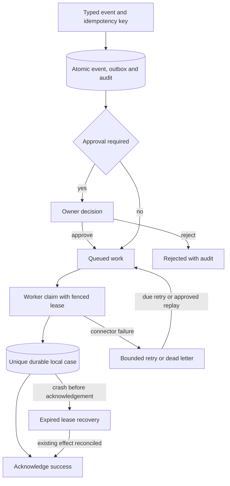

# Architecture and invariants

## Intake and durable intent

A validated support event carries a caller-provided idempotency key and a bounded typed payload. The service canonicalizes the validated payload and compares its digest on repeat requests. A matching retry returns the existing job. A conflicting payload cannot silently replace an accepted event.

The event, durable outbox job and initial audit record enter SQLite in the same write transaction. This prevents an accepted request from losing its execution intent between independent writes. Routing selects a fixed local action from the validated category. No incoming event can choose a shell command, arbitrary URL, filesystem path or tool implementation.

Refund and security reviews require explicit approval. Pending approval is a distinct state that cannot be claimed by a worker. Rejection is terminal; the audit preserves the owner-supplied actor label and reason. The shared workspace token is the authorization boundary; actor text is not an authentication system.

## Claims and recovery

Workers claim due work under SQLite transactional serialization. A claim includes a lease and unique ownership token. Updates must match the active claim, preventing an old worker from overwriting a successor after a lease expires. Attempt counts and retry due times are durable. Expired work becomes recoverable within a bounded attempt policy.

The local case connector uses a unique job/effect identity. Its durable effect and job acknowledgement can occur in separate commits so verification can exercise the failure window between them. A crash in that window leaves recoverable work; the next attempt observes the existing local case and avoids creating a duplicate. This property is local to the shared transactional store and idempotent connector, not universal exactly-once execution.

Errors retry with bounded backoff until the attempt budget is exhausted. Dead-letter replay is explicit and auditable, preserves the effect identity and retains previous history. A future external connector must also fence access where possible and support remote idempotency/reconciliation; a local unique constraint cannot undo an already-sent external message.

## Bounded deployment

The application is a single owner workspace with one SQLite database on a local persistent filesystem. Independent API and worker processes share it through WAL and short transactions. This is suitable for a bounded portfolio/small operations installation, not a claim of distributed queue scale or multi-tenant isolation.

There is no public arbitrary-tool API, financial action or generative model. Synthetic failure injection is explicitly gated by demo mode. Payload limits and capacity checks prevent uncontrolled event storage; list APIs expose bounded recent records. Audit has no delete endpoint but is not cryptographically tamper-proof against an administrator who can modify the SQLite file. Worker logs contain only operational job fields; event subjects, descriptions and caller idempotency keys stay out of those logs.
